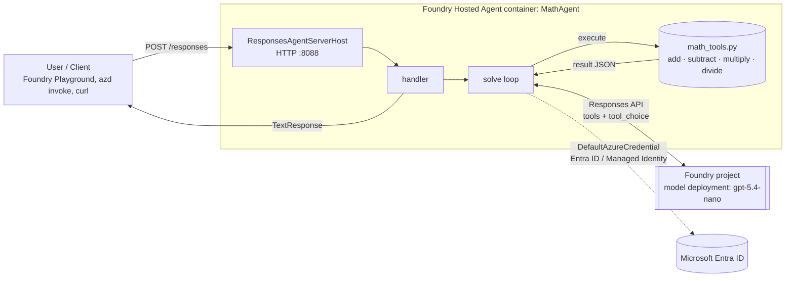
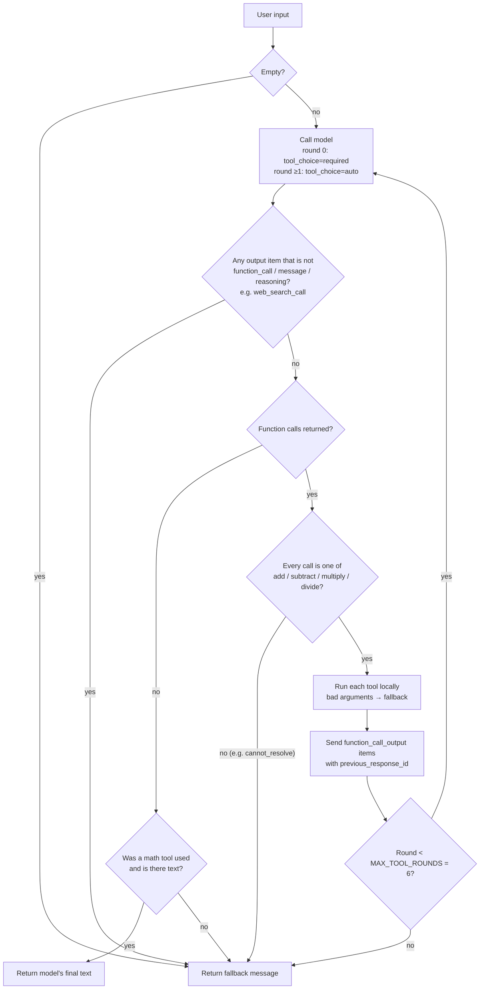

# MathAgent – Tool-calling Math Agent on Microsoft Foundry

`MathAgent` is a Python **hosted agent** for **Microsoft Foundry**. It answers arithmetic questions such as
`what is 2 plus 5` or `2+5` by sending each request to one of four **function tools**: `add`, `subtract`,
`multiply` and `divide`. The model (`gpt-5.4-nano` deployment) never calculates the answer itself. It only
decides which tool to call and with which numbers. The Python tools do the actual math.

If a request can't be handled by these four tools (for example "What's the weather?" or "Write a poem"),
the agent always replies with:

```
Sorry could not resolve your request
```

---

## Table of contents

1. [Key design goals](#1-key-design-goals)
2. [High-level architecture](#2-high-level-architecture)
3. [Components](#3-components)
4. [Request lifecycle (step by step)](#4-request-lifecycle-step-by-step)
5. [Tool-calling loop in detail](#5-tool-calling-loop-in-detail)
6. [Guardrails: forcing tools and blocking web search](#6-guardrails-forcing-tools-and-blocking-web-search)
7. [Tool catalogue](#7-tool-catalogue)
8. [Examples](#8-examples)
9. [Project structure](#9-project-structure)
10. [Configuration](#10-configuration)
11. [Running locally](#11-running-locally)
12. [Debugging in VS Code](#12-debugging-in-vs-code)
13. [Extending the agent](#13-extending-the-agent)
14. [Deployment](#14-deployment)

---

## 1. Key design goals

| Goal | How it's achieved |
|------|-------------------|
| All math is done by tools | `tool_choice="required"` on the first model call, plus a system prompt that forbids calculating without tools |
| Deterministic arithmetic | The four operations are plain Python functions in [src/math-agent/math_tools.py](src/math-agent/math_tools.py) |
| Fixed reply for unsupported requests | A `cannot_resolve` tool plus several code-level checks return `Sorry could not resolve your request` |
| No web search | Only `function` tools are sent to the model, and any non-function tool output (e.g. `web_search_call`) is rejected |
| Hosted on Foundry | Uses the Foundry **Responses protocol** host (`azure-ai-agentserver-responses`) and is deployed with `azd` |
| Uses the Foundry OpenAI client | `AIProjectClient(...).get_openai_client().responses` calls the `gpt-5.4-nano` deployment in your Foundry project |

---

## 2. High-level architecture



**In short:**

1. The client sends a request in the **OpenAI Responses protocol** format to the hosted agent endpoint.
2. `ResponsesAgentServerHost` (Foundry Agent Server SDK) takes care of HTTP, streaming (SSE), health probes and telemetry.
3. The `handler` reads the user text and calls `solve()`.
4. `solve()` calls the **`gpt-5.4-nano`** deployment through the **Foundry OpenAI client** and passes it the list of tools.
5. The model replies with **function calls**. The agent runs them locally and sends the results back.
6. The model writes the final answer (e.g. `2 + 5 = 7`), and the agent returns it as a `TextResponse`.

---

## 3. Components

| Component | File | Responsibility |
|-----------|------|----------------|
| Agent host | [src/math-agent/main.py](src/math-agent/main.py) – `app = ResponsesAgentServerHost(...)` | Exposes the `/responses` endpoint, readiness and liveness probes, and OpenTelemetry. Listens on port `8088`. |
| Request handler | [src/math-agent/main.py](src/math-agent/main.py) – `handler()` | Reads the input text, runs `solve()` in a worker thread, wraps the answer in `TextResponse`, and returns the fallback text on any error. |
| Orchestration loop | [src/math-agent/main.py](src/math-agent/main.py) – `solve()` | Runs the model ↔ tool loop and applies the guardrails. |
| Model client | [src/math-agent/main.py](src/math-agent/main.py) – `_responses_client` | `AIProjectClient.get_openai_client().responses`: an OpenAI-compatible client for the Foundry project that authenticates with `DefaultAzureCredential`. |
| Tools | [src/math-agent/math_tools.py](src/math-agent/math_tools.py) | Python implementations (`MATH_FUNCTIONS`) and JSON-schema tool definitions (`TOOL_DEFINITIONS`). |
| System prompt | [src/math-agent/main.py](src/math-agent/main.py) – `SYSTEM_PROMPT` | Tells the model to always use tools, split multi-step expressions into separate calls, and call `cannot_resolve` for anything that isn't arithmetic. |

### Authentication

`DefaultAzureCredential` works in both environments without any code changes:

- **Locally**: uses your `az login` / `azd auth login` identity.
- **In Foundry**: uses the hosted agent's **managed identity**. `azd deploy` assigns the role the agent needs to call the model deployment.

No API keys are stored in code or configuration.

---

## 4. Request lifecycle (step by step)

```mermaid
sequenceDiagram
    autonumber
    actor User
    participant Host as ResponsesAgentServerHost
    participant Handler as handler()
    participant Loop as solve()
    participant LLM as gpt-5.4-nano (Foundry)
    participant Tools as math_tools

    User->>Host: POST /responses { input: "what is 2 plus 5" }
    Host->>Handler: CreateResponse + ResponseContext
    Handler->>Loop: solve("what is 2 plus 5")
    Loop->>LLM: responses.create(tools=[add,subtract,multiply,divide,cannot_resolve], tool_choice="required")
    LLM-->>Loop: function_call add {"a":2,"b":5}
    Loop->>Tools: add(2, 5)
    Tools-->>Loop: {"result": 7}
    Loop->>LLM: responses.create(previous_response_id, input=[function_call_output], tool_choice="auto")
    LLM-->>Loop: message "2 + 5 = 7"
    Loop-->>Handler: "2 + 5 = 7"
    Handler-->>Host: TextResponse
    Host-->>User: response.completed → "2 + 5 = 7"
```

---

## 5. Tool-calling loop in detail



Notes:

- **Multi-step expressions** such as `(2 + 3) * 4` are handled over several rounds. The model calls `add`, gets `5`, then calls `multiply(5, 4)`. It may also return several calls in one round (parallel tool calls).
- **Conversation state** for the loop is kept in Foundry using `previous_response_id`, so only the new tool outputs are sent each round. The system prompt is sent again on every call because `instructions` aren't carried over between responses.
- **Division by zero**: `divide` returns `{"error": "Division by zero is undefined."}` and the model passes that message on to the user.
- **Safety limit**: `MAX_TOOL_ROUNDS = 6` stops runaway loops.

---

## 6. Guardrails: forcing tools and blocking web search

| Layer | Mechanism | Effect |
|-------|-----------|--------|
| 1. Tool list | Only `type: "function"` tools are passed in `tools=`. No `web_search`, `file_search`, `code_interpreter` or MCP tools are declared. | The model has no way to search the web. |
| 2. Forced tool use | `tool_choice="required"` on the first call. | The model **must** call a tool. A text-only answer isn't possible. |
| 3. Explicit escape hatch | `cannot_resolve` tool. | Out-of-scope requests still go through a tool, and the code turns that call into the fallback message. |
| 4. Output allow-list | `ALLOWED_OUTPUT_TYPES = {"function_call", "message", "reasoning"}`. | If any other output item appears (for example `web_search_call`), the agent returns the fallback message. |
| 5. Tool-name allow-list | Only names in `MATH_FUNCTIONS` are run. | Unknown or hallucinated tool names lead to the fallback message. |
| 6. No-tool answer check | A final text answer is accepted only if at least one math tool ran. | The model can't answer with math it did itself. |
| 7. Strict schemas | `"strict": true`, `additionalProperties: false`, numeric `a`/`b`. | Arguments are well-formed numbers. Parse failures lead to the fallback message. |
| 8. Error isolation | `handler()` catches exceptions. | Users never see stack traces, only the fallback message. Details go to the logs. |

---

## 7. Tool catalogue

| Tool | Parameters | Returns | Example |
|------|-----------|---------|---------|
| `add` | `a: number`, `b: number` | `{"result": a + b}` | `add(2, 5)` → `7` |
| `subtract` | `a: number`, `b: number` | `{"result": a - b}` | `subtract(9, 4)` → `5` |
| `multiply` | `a: number`, `b: number` | `{"result": a * b}` | `multiply(3, 4)` → `12` |
| `divide` | `a: number`, `b: number` | `{"result": a / b}` or `{"error": ...}` | `divide(10, 4)` → `2.5` |
| `cannot_resolve` | – | *(never executed)* | Tells the agent the request is out of scope |

Whole-number results are returned as integers (`7`, not `7.0`).

---

## 8. Examples

| User prompt | Tool calls | Reply |
|-------------|-----------|-------|
| `what is 2 plus 5` | `add(2,5)` | `2 + 5 = 7` |
| `2+5` | `add(2,5)` | `2 + 5 = 7` |
| `12 divided by 4` | `divide(12,4)` | `12 / 4 = 3` |
| `(2+3)*4` | `add(2,3)` → `multiply(5,4)` | `(2 + 3) * 4 = 20` |
| `10 / 0` | `divide(10,0)` → error | Explains that division by zero is undefined |
| `What's the weather in Seattle?` | `cannot_resolve()` | `Sorry could not resolve your request` |
| `Search the web for pi` | `cannot_resolve()` | `Sorry could not resolve your request` |
| `square root of 16` | `cannot_resolve()` | `Sorry could not resolve your request` |

---

## 9. Project structure

```
FoundryAgentWithTool/
├── AGENTS.md                  # Instructions for AI coding assistants
├── README.md                  # This document
├── deployment.md              # Step-by-step CLI deployment to Microsoft Foundry
├── .vscode/
│   ├── launch.json            # Attach debugger (debugpy :5679)
│   └── tasks.json             # Start agent + open Foundry Toolkit Agent Inspector
└── src/
    └── math-agent/
        ├── main.py            # Hosted agent: server host, handler, tool-calling loop
        ├── math_tools.py      # Tool implementations + JSON schemas
        ├── requirements.txt   # Python dependencies
        ├── .env.example       # Template for local environment variables
        └── .agentignore       # Files excluded from the code-deploy ZIP
```

`azure.yaml` and `.azure/` are created by `azd ai agent init` during deployment (see [deployment.md](deployment.md)).

---

## 10. Configuration

| Variable | Required | Description |
|----------|----------|-------------|
| `FOUNDRY_PROJECT_ENDPOINT` | Yes | `https://<account>.services.ai.azure.com/api/projects/<project>`. Injected automatically when hosted in Foundry. |
| `AZURE_AI_MODEL_DEPLOYMENT_NAME` | Yes | Model deployment name: **`gpt-5.4-nano`**. |
| `APPLICATIONINSIGHTS_CONNECTION_STRING` | Optional | Enables telemetry locally. Injected automatically when hosted. |

For local development, copy [src/math-agent/.env.example](src/math-agent/.env.example) to `src/math-agent/.env` and fill in the values. `.env` is listed in `.gitignore` and `.agentignore`, so it's never committed or deployed.

---

## 11. Running locally

Prerequisites: **Python 3.12+**, Azure CLI (`az login`), and access to a Foundry project that has a `gpt-5.4-nano` deployment. Your identity needs the **Azure AI User** role on the project.

```bash
cd src/math-agent
python3.12 -m venv .venv
source .venv/bin/activate
pip install -r requirements.txt
cp .env.example .env        # then edit the endpoint
python main.py              # server listens on http://localhost:8088
```

Test it from another terminal:

```bash
curl -sS -X POST http://localhost:8088/responses \
  -H "Content-Type: application/json" \
  -d '{"input": "what is 2 plus 5", "stream": false}'

curl -sS -X POST http://localhost:8088/responses \
  -H "Content-Type: application/json" \
  -d '{"input": "what is the capital of France?", "stream": false}'
# -> "Sorry could not resolve your request"
```

After `azd ai agent init` (see [deployment.md](deployment.md)), you can also use `azd ai agent run` and `azd ai agent invoke --local "2+5"`.

---

## 12. Debugging in VS Code

1. Create the virtual environment at `src/math-agent/.venv` (see above). The VS Code tasks use this interpreter.
2. Press **F5** and select **Debug Local Agent/Workflow HTTP Server**.
3. The agent starts under `debugpy` on port `5679`, the server listens on `8088`, and the **Foundry Toolkit Agent Inspector** opens so you can chat with the agent and view traces.
4. Set breakpoints in `solve()` or in the tool functions to step through each tool call.

---

## 13. Extending the agent

To add a new operation (for example `power`):

1. Implement `def power(a: float, b: float) -> dict` in [src/math-agent/math_tools.py](src/math-agent/math_tools.py).
2. Register it in `MATH_FUNCTIONS`.
3. Add `_binary_tool("power", "Raise a to the power b.")` to `TOOL_DEFINITIONS`.
4. Mention the new operation in `SYSTEM_PROMPT`.

The guardrails pick up new tools automatically because they use `MATH_FUNCTIONS` as the allow-list.

---

## 14. Deployment

See **[deployment.md](deployment.md)** for step-by-step Azure Developer CLI (`azd`) commands that deploy MathAgent as a hosted agent to your Microsoft Foundry project.
