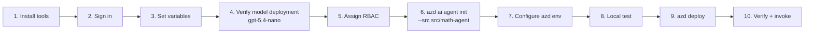

# Deploying MathAgent to Microsoft Foundry

This guide walks through deploying **MathAgent** as a **hosted agent** to an existing **Microsoft Foundry project** with the Azure Developer CLI (`azd`) and the Azure CLI (`az`). The agent uses the model deployment **`gpt-5.4-nano`**.

> All commands are written for macOS/Linux (bash/zsh) and run from the repository root (`FoundryAgentWithTool/`) unless noted otherwise.

---

## Overview



`azd deploy` zips `src/math-agent/` (excluding files listed in `.agentignore`), uploads it to Foundry, builds the Python runtime remotely, and registers a new **agent version**. Running it again creates a new version.

---

## Step 1 – Install prerequisites

| Tool | Minimum version | Install / check |
|------|-----------------|-----------------|
| Azure CLI | latest | `brew install azure-cli` · `az version` |
| Azure Developer CLI | 1.27.1 | `brew tap azure/azd && brew install azd` · `azd version` |
| azd Foundry agents extension | latest | `azd extension install azure.ai.agents` |
| Python | 3.12+ | `python3.12 --version` |

```bash
az version
azd version
azd extension install azure.ai.agents     # or: azd extension upgrade azure.ai.agents
azd extension list --installed
```

---

## Step 2 – Sign in to Azure

```bash
az login
azd auth login
```

If you have more than one tenant, add `--tenant <tenant-id>` to both commands.

---

## Step 3 – Set shell variables for your Foundry project

Replace the placeholders with your own values:

```bash
export SUBSCRIPTION_ID="<subscription-id>"
export RESOURCE_GROUP="<resource-group>"
export FOUNDRY_ACCOUNT="<foundry-account-name>"   # the Foundry (AI Services) resource
export FOUNDRY_PROJECT="<foundry-project-name>"
export LOCATION="<region>"                         # e.g. eastus2
export MODEL_DEPLOYMENT="gpt-5.4-nano"

az account set --subscription "$SUBSCRIPTION_ID"
```

Get the project's ARM resource ID and endpoint:

```bash
export PROJECT_ID=$(az resource show \
  --resource-group "$RESOURCE_GROUP" \
  --name "$FOUNDRY_ACCOUNT/$FOUNDRY_PROJECT" \
  --resource-type "Microsoft.CognitiveServices/accounts/projects" \
  --query id -o tsv)

az resource show --ids "$PROJECT_ID" --query "properties.endpoints" -o json
```

Copy the **AI Foundry API** endpoint from the output. It looks like `https://<account>.services.ai.azure.com/api/projects/<project>`.

```bash
export PROJECT_ENDPOINT="https://$FOUNDRY_ACCOUNT.services.ai.azure.com/api/projects/$FOUNDRY_PROJECT"
echo "$PROJECT_ID"
echo "$PROJECT_ENDPOINT"
```

---

## Step 4 – Verify the `gpt-5.4-nano` model deployment

```bash
az cognitiveservices account deployment list \
  --resource-group "$RESOURCE_GROUP" \
  --name "$FOUNDRY_ACCOUNT" \
  --query "[].{name:name, model:properties.model.name, version:properties.model.version, sku:sku.name}" \
  --output table
```

If `gpt-5.4-nano` is **not** listed, find the available version and create the deployment:

```bash
az cognitiveservices account list-models \
  --resource-group "$RESOURCE_GROUP" \
  --name "$FOUNDRY_ACCOUNT" \
  --query "[?name=='gpt-5.4-nano'].{name:name, version:version, format:format}" \
  --output table

az cognitiveservices account deployment create \
  --resource-group "$RESOURCE_GROUP" \
  --name "$FOUNDRY_ACCOUNT" \
  --deployment-name "$MODEL_DEPLOYMENT" \
  --model-name "gpt-5.4-nano" \
  --model-version "<version-from-previous-command>" \
  --model-format OpenAI \
  --sku-name GlobalStandard \
  --sku-capacity 10
```

---

## Step 5 – Assign RBAC for your developer identity

Your signed-in user needs to be able to call the model (for local testing) and create agents in the project (for deployment).

```bash
export MY_OBJECT_ID=$(az ad signed-in-user show --query id -o tsv)

az role assignment create \
  --assignee-object-id "$MY_OBJECT_ID" \
  --assignee-principal-type User \
  --role "Azure AI User" \
  --scope "$PROJECT_ID"
```

> To deploy, you also need **Contributor** (or **Owner**) on the resource group or Foundry account, so that `azd` can register the agent and assign the agent's managed identity its role. Ask your subscription admin if you don't have it.

---

## Step 6 – Initialize the azd project from the existing agent code

This command creates `azure.yaml` and an `.azure/<env>` environment that point at your **existing** project and model deployment. It doesn't create any Azure resources.

```bash
azd ai agent init \
  --src src/math-agent \
  --project-id "$PROJECT_ID" \
  --model-deployment "$MODEL_DEPLOYMENT" \
  --agent-name math-agent \
  --protocol responses \
  --deploy-mode code \
  --runtime python_3_13 \
  --entry-point main.py \
  --no-prompt
```

| Flag | Purpose |
|------|---------|
| `--src src/math-agent` | Use the existing MathAgent source folder |
| `--project-id` | Target the existing Foundry project (ARM ID from Step 3) |
| `--model-deployment gpt-5.4-nano` | Use the existing model deployment |
| `--agent-name math-agent` | Foundry agent name. Deploying again with the same name creates a new version. |
| `--protocol responses` | MathAgent uses the OpenAI **Responses** protocol |
| `--deploy-mode code` | Upload the source as a ZIP. Foundry builds it remotely, so no Docker is needed. |
| `--runtime python_3_13` / `--entry-point main.py` | Python runtime and entry file |

### Check the generated `azure.yaml`

Open `azure.yaml` and confirm the following:

- There's exactly **one** agent service (`math-agent`). A `math-agent-2` entry means init ran twice.
- `codeConfiguration.entryPoint` is `main.py` and `runtime` is `python_3_13`.
- The agent's `env` section contains `AZURE_AI_MODEL_DEPLOYMENT_NAME: ${AZURE_AI_MODEL_DEPLOYMENT_NAME}`. A literal `{{AZURE_AI_MODEL_DEPLOYMENT_NAME}}` means model resolution failed. In that case, replace it with `${AZURE_AI_MODEL_DEPLOYMENT_NAME}`.
- Optionally, set `displayName: MathAgent` and a `description` such as *"Solves arithmetic using add/subtract/multiply/divide function tools; replies 'Sorry could not resolve your request' to anything else."*

The result should look roughly like this:

```yaml
services:
  math-agent:
    host: azure.ai.agent
    kind: hosted
    project: src/math-agent
    language: python
    name: math-agent
    displayName: MathAgent
    codeConfiguration:
      runtime: python_3_13
      entryPoint: main.py
    protocols:
      - protocol: responses
        version: 2.0.0
    env:
      AZURE_AI_MODEL_DEPLOYMENT_NAME: ${AZURE_AI_MODEL_DEPLOYMENT_NAME}
```

---

## Step 7 – Configure the azd environment

```bash
azd env set AZURE_SUBSCRIPTION_ID "$SUBSCRIPTION_ID"
azd env set AZURE_LOCATION "$LOCATION"
azd env set AZURE_AI_PROJECT_ENDPOINT "$PROJECT_ENDPOINT"
azd env set AZURE_AI_MODEL_DEPLOYMENT_NAME "$MODEL_DEPLOYMENT"
azd env set AZURE_TENANT_ID "$(az account show --query tenantId -o tsv)"

azd env get-values
```

Also create the local `.env` file for running without azd:

```bash
cat > src/math-agent/.env <<EOF
FOUNDRY_PROJECT_ENDPOINT=$PROJECT_ENDPOINT
AZURE_AI_MODEL_DEPLOYMENT_NAME=$MODEL_DEPLOYMENT
EOF
```

`.env` is listed in `src/math-agent/.agentignore`, so it's never uploaded.

---

## Step 8 – Test locally before deploying

Create the virtual environment **inside** `src/math-agent/`, which is where `azd ai agent run` looks for it:

```bash
cd src/math-agent
python3.12 -m venv .venv
source .venv/bin/activate
pip install uv
cd -
```

Start the agent (terminal 1). This keeps running on `http://localhost:8088`:

```bash
azd ai agent run --no-client
```

Invoke it (terminal 2):

```bash
azd ai agent invoke --local "what is 2 plus 5"          # -> 2 + 5 = 7
azd ai agent invoke --local "2+5"                       # -> 2 + 5 = 7
azd ai agent invoke --local "(2+3)*4"                   # -> 20
azd ai agent invoke --local "what's the weather today?" # -> Sorry could not resolve your request
```

Press `Ctrl+C` in terminal 1 to stop the server.

---

## Step 9 – Deploy to Microsoft Foundry

```bash
azd deploy
```

`azd deploy` packages `src/math-agent/`, uploads it, builds it remotely, creates a new agent version, and assigns the agent's managed identity access to the project. This can take several minutes.

> **Note:** You're using an existing project, so `azd provision` isn't needed. Only run `azd provision` if `azd deploy` explicitly asks for it.

---

## Step 10 – Verify and invoke the deployed agent

```bash
azd ai agent show --output json
```

Check for `"status": "active"` (or `"deployed"`), the agent version, the `agent_endpoints` map and the `playground_url`.

Test the remote agent (each call is billed):

```bash
azd ai agent invoke "what is 2 plus 5"
azd ai agent invoke "12 divided by 4"
azd ai agent invoke "search the web for the value of pi"   # -> Sorry could not resolve your request
```

Stream live logs from the running agent:

```bash
azd ai agent monitor
```

You can also test the agent in the **Foundry portal → your project → Agents → math-agent → Playground** (use the `playground_url` from `azd ai agent show`).

### Call it from any HTTP client

```bash
TOKEN=$(az account get-access-token --resource https://ai.azure.com --query accessToken -o tsv)

curl -sS -X POST "<agent responses endpoint from 'azd ai agent show'>" \
  -H "Authorization: Bearer $TOKEN" \
  -H "Content-Type: application/json" \
  -d '{"input": "2+5", "stream": false}'
```

---

## Step 11 – Update the agent

After you change `main.py` or `math_tools.py`, redeploy:

```bash
azd deploy
azd ai agent show --output json   # confirm the new version
azd ai agent invoke "7 times 6"
```

To call a specific version: `azd ai agent invoke --version <n> "2+5"`.

---

## Step 12 (optional) – Generate and run an evaluation suite

```bash
azd ai agent eval generate \
  --gen-instruction "Arithmetic agent that must solve add/subtract/multiply/divide problems via function tools and reply 'Sorry could not resolve your request' to anything else" \
  --no-wait

azd ai agent eval run
```

---

## Cleanup

This deployment uses an **existing** Foundry project. Don't run `azd down` unless you're sure it should remove resources that azd manages. To remove only the agent, delete `math-agent` from the Foundry portal (**Agents → math-agent → Delete**).

---

## Appendix – Deploy into a new Foundry project instead

If you don't have a project yet, let azd create one together with the `gpt-5.4-nano` deployment:

```bash
azd ai agent init \
  --src src/math-agent \
  --model gpt-5.4-nano \
  --agent-name math-agent \
  --protocol responses \
  --deploy-mode code \
  --runtime python_3_13 \
  --entry-point main.py \
  --no-prompt

azd env set AZURE_SUBSCRIPTION_ID "$SUBSCRIPTION_ID"
azd env set AZURE_LOCATION "$LOCATION"
azd env set AZURE_AI_PROJECT_NAME "<new-project-name>"

azd provision      # creates resource group, Foundry account + project, gpt-5.4-nano deployment, App Insights
azd env get-values # copy FOUNDRY/AZURE_AI_PROJECT_ENDPOINT into src/math-agent/.env
azd deploy
azd ai agent invoke "2+5"
```

`azd down` removes all of these resources when you no longer need them.

---

## Troubleshooting

| Symptom | Fix |
|---------|-----|
| `404 DeploymentNotFound` on invoke | `AZURE_AI_MODEL_DEPLOYMENT_NAME` doesn't match a deployment. Re-run Step 4 and `azd env set AZURE_AI_MODEL_DEPLOYMENT_NAME gpt-5.4-nano`. azd env values take priority over `.env`. |
| `401/403` locally | Run `az login`, and check the **Azure AI User** role from Step 5. |
| `--runtime must be one of ...` | Use the full token `python_3_13` (not `python`). |
| `entryPoint` mismatch | Make sure `azure.yaml` has `entryPoint: main.py`. |
| Postdeploy hook fails with missing `AZURE_TENANT_ID` | `azd env set AZURE_TENANT_ID "$(az account show --query tenantId -o tsv)"` and then `azd deploy` again. |
| `Public access is disabled` / `403` from a private endpoint | The Foundry account is network-isolated. Run the commands from inside the VNet. See [secure connection methods](https://learn.microsoft.com/azure/foundry/how-to/configure-private-link#choose-a-secure-connection-method-to-foundry). |
| Every answer is `Sorry could not resolve your request` | Look at the logs (`azd ai agent monitor`). A model or auth error is caught by the handler and turned into the fallback message. |

## References

- [Foundry hosted agents](https://learn.microsoft.com/azure/ai-foundry/agents/concepts/hosted-agents?view=foundry)
- [Quickstart: hosted agent with azd](https://learn.microsoft.com/azure/foundry/agents/quickstarts/quickstart-hosted-agent?view=foundry&pivots=azd)
- [Foundry samples – hosted agents (Python)](https://github.com/microsoft-foundry/foundry-samples/tree/main/samples/python/hosted-agents)
